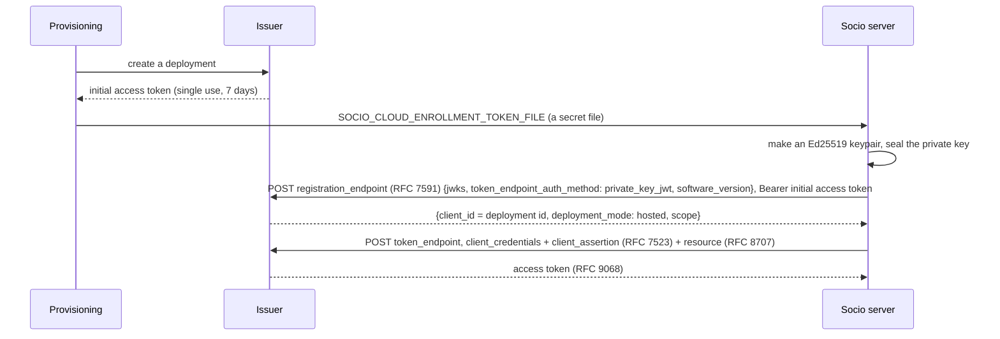
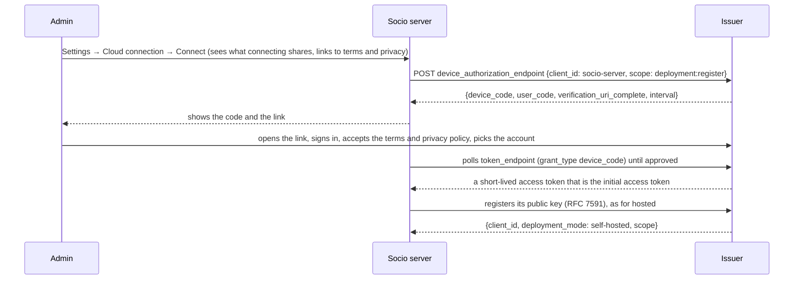

# Cloud services protocol: a deployment identity for Socio's shared services

Status: **draft specification.** Nothing here is built yet. It describes the public protocol between a Socio deployment and the shared services Ingenio Ventures runs for Socio (the push relay, the release feed and an AI-reply report collector), the deployment's own behavior, and what leaves a workspace. The issuer and collector services themselves are not part of this repository. Open points are marked **(open)**.

## 1. Overview

Every deployment, hosted or self-hosted, can get a machine-to-machine identity that lets it call certain Socio services. The identity says which deployment is calling, its **deployment mode** (`hosted` or `self-hosted`, meaning only who runs the servers) and the **scopes** it may use. The deployment can't set any of these itself.

Connecting is never required. A self-hosted or air-gapped deployment keeps working with no connection (§2.8) and can run its own push relay (§5.1). This identity faces **outward**, from a deployment to the shared services. It never authorizes anything inside a workspace: service accounts (`cbk_`), socio-actor credentials (`cbsa_`, `cbob_`) and plugin identities (`cbpi_`) are unchanged.

## 2. The protocol: a standard OAuth profile

### 2.1 Standards used

| Need                             | Standard                                                                                   |
| -------------------------------- | ------------------------------------------------------------------------------------------ |
| A self-hosted admin signs in     | **RFC 8628**, Device Authorization Grant                                                   |
| Hosted enrollment                | **RFC 7591** initial access token, from provisioning                                       |
| Registering the deployment's key | **RFC 7591** dynamic client registration, with `jwks` and `private_key_jwt`                |
| A signed request for a token     | **RFC 7523** §2.2 client assertion, on a `client_credentials` grant (**RFC 6749** §4.4)    |
| One audience per token           | **RFC 8707** resource indicators                                                           |
| Token format                     | **RFC 9068**, JWT access tokens                                                            |
| Discovery and the issuer's keys  | **RFC 8414** server metadata and its `jwks_uri`                                            |
| Revocation                       | the IETF OAuth Token Status List (§2.5)                                                    |
| Errors                           | RFC 6749 §5.2 (`invalid_client`, `invalid_grant`), RFC 8628 §3.5 (`authorization_pending`) |

Each piece is already specified and reviewed, so a client can use a maintained WebCrypto library (for example `oauth4webapi`, which covers the device grant, `private_key_jwt` and JWT access-token checks) instead of custom code.

**Discovery.** The client reads `SOCIO_CLOUD_ISSUER` (default `https://cloud.socio.sh`) and fetches `/.well-known/oauth-authorization-server` (RFC 8414) for every endpoint and the `jwks_uri`. No other URL is built into the client.

**Profile limits.** The only public client is `socio-server` (§2.2). There are no redirect URIs and no refresh tokens: a deployment always holds its key and asks for a new access token.

### 2.2 Enrollment

Every path ends the same way. The deployment makes its own keypair, registers its public key with an **initial access token**, and gets back a `client_id`, which is its **deployment id**. Only the way the initial access token is obtained differs.

**Hosted (provisioning).** The hosting agreement covers the terms and privacy policy.



The app registers at startup if it has no identity yet. The token is single use and expires after 7 days, so leaving it in place after use is harmless.

**Self-hosted (device login).** Opt-in only. There is no automatic or anonymous enrollment.



- `socio-server` is a public client id, the same in every build. It may use only the device grant and only the scope `deployment:register`.
- Signing in and accepting the terms happen on the issuer's page. The app also records in the workspace audit which admin connected, when, and the terms version the issuer returned.
- The deployment belongs to the account that approved the code. That cloud account is separate from any account inside the deployment, and there is no single sign-on between them.
- **The issuer's assignment wins.** The deployment mode comes from how the deployment enrolled, as the issuer recorded it. Nothing the app sends can change it.

### 2.3 Key format: signed requests, not a bearer secret

The deployment holds a private key, and the issuer stores only the public key. A leaked issuer database can't impersonate a deployment, and no secret travels after enrollment. The deployment exchanges a signed assertion for a short-lived access token. Services check that token against the issuer's published keys, with no per-request lookup.

- **Algorithm:** Ed25519 (EdDSA JWS), available in WebCrypto on Workers and in Node. ES256 is the alternative **(open)**.
- **The client assertion** (deployment → issuer), per RFC 7523 §3:
  `{iss: <client_id>, sub: <client_id>, aud: <issuer>, iat, exp: iat + 300, jti}`, header `kid`.
- **The access token** (issuer → deployment), per RFC 9068, header `typ: at+jwt`:
  `{iss: <issuer>, sub: <client_id>, client_id, aud: <one service origin>, deployment_mode, scope, iat, exp: iat + 3600, jti, status}` (§2.5, §2.6).
  There is one audience per token, so the push relay refuses a token issued for the collector.

### 2.4 Storage in the deployment

- **The private key** is sealed under the data key in `secret_settings` (`src/server/settings/secret-settings.ts`), the way the VAPID key is sealed. It is never in env, a file or a log. It follows the data through backups, restores and cutovers.
- **If the data key is lost,** the sealed key can't be opened. The app shows "Cloud connection lost" to admins and does nothing else. A hosted deployment gets a new initial access token for the **same** deployment id, and a self-hosted admin connects again. The new key replaces the old one (§2.5).
- **The access-token cache** is in memory only, per audience, and renewed at 80% of each token's life. Each runtime mints its own tokens.

### 2.5 Rotation and revocation

**Routine rotation.** There are three triggers and one mechanism:

- automatic, every 90 days **(open: the interval)**;
- a command line run in the app container: `node dist/server/server/cloud/cloud-cli.js rotate-key`, which hands the request to the running server over its private Unix socket (also `status` and `disconnect`);
- provisioning: a new initial access token for the same deployment id re-enrolls it.

The mechanism: the app makes a new keypair and sends the issuer's key-rotation endpoint a `jwks` that holds both keys. The call is authenticated by a client assertion signed with the **current** key. After a 24-hour overlap, the app sends the new key alone.

**Rotation after a loss** is re-enrollment for the same deployment id (§2.4). The issuer retires every old key at once.

**Revocation uses the IETF OAuth Token Status List** ([draft-ietf-oauth-status-list](https://datatracker.ietf.org/doc/draft-ietf-oauth-status-list/)): a signed, compressed bitstring that every service fetches and caches. The issuer learns nothing per token, and services check offline. Per-request introspection (RFC 7662) was rejected because it reports every use to the issuer and fails whenever the issuer does. RFC 7009 was rejected because it covers a client revoking its own tokens.

- Each deployment gets a fixed index in one status list when it registers, and every access token carries `status: {status_list: {idx, uri}}`. Revoking a deployment sets its bit (`0` valid, `1` invalid), so all its tokens fail at once.
- The list is a Status List Token (`typ: statuslist+jwt`, served as `application/statuslist+jwt`), signed with the issuer's keys, with a `ttl` of 5 minutes **(open: the number)**.
- Services that pay per request (the push relay, the collector) check the list. Others may rely on the token's 1-hour life.
- The token endpoint refuses a revoked deployment with `invalid_client`. The app then clears the connection (§3.1).
- **Privacy:** one index per deployment links that deployment's tokens, which `sub` already does. The list says nothing else.

**Issuer key rotation:** the issuer publishes current and next keys at its `jwks_uri`. Services cache them for an hour and re-read on an unknown `kid`.

### 2.6 What the identity carries

| Claim              | Values                                                  | Set by                                       |
| ------------------ | ------------------------------------------------------- | -------------------------------------------- |
| `sub`, `client_id` | the deployment id, `dep_` + 26 characters (ULID)        | the issuer, at registration                  |
| `deployment_mode`  | `hosted` or `self-hosted`, nothing else                 | the issuer, from how the deployment enrolled |
| `scope`            | space-separated, from the list below                    | the issuer                                   |
| `aud`              | one service origin, from the `resource` parameter       | the issuer                                   |
| `status`           | the Token Status List reference (§2.5)                  | the issuer                                   |
| `tier`             | **reserved**, not issued; services must ignore it today | n/a                                          |

Services must ignore claims they don't know, so a new claim needs no spec change.

**Scopes, first set:** `reports:write` (§4), `push:send` (§5.1), `updates:read` (§5.2) and `deployment:register` (device login only). `stats:write` is reserved (§2.7). Every enrolled deployment gets `reports:write`, `push:send` and `updates:read`. Whether it uses `reports:write` is the workspace's own setting (§3.2).

### 2.7 Sync (small on purpose, open to more)

The app sends `POST <issuer>/v1/sync` once a day and at startup, with an access token for the issuer:

```json
{ "v": 1, "deployment": { "version": "0.47.0", "origin": "https://…", "fingerprint": "…" }, "sections": {} }
```

The answer is `{"deployment_mode", "scope", "status", "accepts": [], "notices": []}`. That is how the app learns its mode and scopes for the UI. Services never trust the app's copy. No users, counts, names or emails are sent.

**Extensibility.** Version 1 sends no usage statistics. Later data goes in `sections`, one named section each (for example `stats`):

- the client sends a section only when the last answer's `accepts` named it, its scope is in the token, and any consent it needs is on;
- the issuer ignores sections it doesn't know, and the client ignores answer fields it doesn't know;
- adding a section is a new name, a scope and a privacy-policy update, not a protocol change. What a section holds is published with it.

### 2.8 Offline and air-gapped

- **No connection is a normal state.** With `SOCIO_CLOUD=off`, or with no identity, the `cloud` module never calls out. Every feature that needs it is hidden or uses the self-hosted path, such as the deployment's own push relay (§5.1).
- **There is no offline enrollment in v1,** because nothing needs unlocking.

### 2.9 How a service checks a caller

A service checks, with WebCrypto only:

- the signature, against the issuer's JWKS (cached an hour);
- `typ: at+jwt` and `iss`;
- `aud`, which must be exactly its own origin;
- `exp` and `nbf`, with a minute of slack;
- `scope`;
- the status list.

The push relay does this inside `apps/push-relay` itself.

## 3. The workspace side (this repository)

### 3.1 The `cloud` module

A new server module, `src/server/cloud/`.

- **Enrollment** runs at startup when `SOCIO_CLOUD_ENROLLMENT_TOKEN_FILE` is set and no identity exists, or when an admin connects (§2.2). It is retried with backoff on network errors and never blocks startup.
- **The key** is sealed in `secret_settings`, and the access-token cache is in memory (§2.4).
- **Sync** runs daily and at startup (§2.7).
- **On `invalid_client`,** the module clears its cached tokens, sets "Not connected (revoked)", stops calling, and tells admins once.
- **Settings → Cloud connection,** for admins, shows the status, deployment id, deployment mode, scopes, last sync and the service hosts the deployment talks to. A self-hosted deployment also gets **Connect** (§2.2) and **Disconnect** (a client-assertion call that disables the deployment). Key rotation isn't a button (§2.5).
- **The CLI** (§2.5) has `status`, `rotate-key` and `disconnect`.

### 3.2 The workspace setting

- **"Share AI reply reports"** is off by default.
- It shows only when the deployment is connected and its scopes include `reports:write`, hosted or self-hosted. On an unconnected deployment it isn't there, and the forwarder never runs.
- Only the workspace's admins may change it.
- **Consent record:** turning it on shows what leaves (§3.4) and records in the workspace audit who agreed, when, and which text version. Turning it off drops anything still queued.

### 3.3 The forwarder and its queue

- **The trigger** is a thumbs-down (`kind: 'down'`) added through `PUT /conversations/:id/messages/:messageId/reactions/down` (`src/server/context/reaction-routes.ts`), or through the Telegram path, while the setting is on.
- **A reason.** A reason picker after a thumbs-down (offensive, harmful, wrong, other, plus a note of at most 1,000 characters), and a confirmation each time, on web and mobile; the client contract is docs/specs/REPLY-REPORTS.md. Telegram has no confirmation, so a thumbs-down there is never a report.
- **The outbox.** In the same unit of work as the reaction row, a row is added to a new `cloud_outbox` table: `{id, kind: 'ai-report', payload (sealed JSON), createdAt, attempts, nextAt, sentAt, failedAt, lastError}`. `id` is a **report id**: a new UUIDv7 made for this report, which is also its idempotency key. It isn't the workspace's id, the deployment's id or a message id. The payload is snapshotted at that moment, so a later edit or deletion of the chat doesn't change what was reported.
- **Sending.** A loop runs every minute and sends up to 20 due rows, oldest first. With several app replicas, each row is claimed with a lease before it is sent.
    - `201`, or `200` (already stored): `sentAt` is set, and the reaction shows **Shared**.
    - `401`: renew the token once, then retry. `invalid_client` on renewal stops the queue (§3.1).
    - `429` or `503`: wait for `Retry-After`.
    - Network errors and other `5xx`: back off 1 min, 5 min, 30 min, 2 h, then every 6 h.
    - `400`, `403` and `413` are permanent: `failedAt` is set, and admins see a count on the Cloud connection card.
    - A row still unsent after 7 days fails.
- **Removing the thumbs-down** (or replacing it with a thumbs-up) before the report is sent deletes the outbox row. After it is sent, it stays sent, and at the collector for its year: no retraction is sent.
- **Retention in the workspace:** sent and failed rows are deleted after 30 days. The reaction's "shared" mark stays.

### 3.4 Privacy promises: what leaves the workspace

| Leaves                                                                                       | Stays                                                                              |
| -------------------------------------------------------------------------------------------- | ---------------------------------------------------------------------------------- |
| The reply's text (the message the person reacted to, as shown)                               | The person's name, email and user id                                               |
| The user message it answered (text only; attachments become `[attachment: image]` and so on) | The rest of the conversation, the run's steps, tool calls and their output, files  |
| The model id, a per-deployment hash of the socio's id, the reason, the note and the time     | The conversation and message ids (only a per-deployment hash, to group duplicates) |
| The surface (web, mobile, Telegram) and the app version                                      | Anything about other people in a room                                              |
| The deployment id (from the token)                                                           | The workspace's origin (the issuer knows it; the report doesn't repeat it)         |

- Both texts go through `redactSocioTokens()` (`packages/foundation/src/actors/redact.ts`) and a secret-pattern pass before they are queued, so a reply that echoes a credential doesn't carry it out.
- While sharing is on, the person who reacts confirms each report on a screen that says what goes, and that another person's message goes too when the reply answered someone else (`promptByOther`).
- Reports are kept for 1 year, then deleted.
- Sync sends the version, origin and fingerprint only (§2.7). Anything more is a new published section, behind a scope and the terms.
- The push relay learns which deployment sends each push (§5.1). It never learns the push's content, which stays end-to-end encrypted.

## 4. The report protocol

`POST https://reports.socio.sh/v1/reports`, with `Content-Type: application/json` and `Authorization: Bearer <access token for https://reports.socio.sh>`.

```json
{
    "id": "0193…",
    "reportedAt": 1763300000000,
    "reason": "offensive",
    "note": "optional, ≤ 1000 chars",
    "reply": { "text": "…", "truncated": false, "at": 1763299990000 },
    "prompt": { "text": "…", "truncated": false },
    "promptByOther": false,
    "model": "<model id>",
    "socio": "<per-deployment hash of the socio's id>",
    "surface": "mobile",
    "appVersion": "0.34.1",
    "threadHash": "…"
}
```

`id` is the report id from §3.3. `promptByOther` comes only with `prompt`: true when the person who reacted didn't write the message the reply answered (a room). `socio` and `threadHash` are HMAC-SHA256 values under keys derived from one the deployment makes and never sends, with a label each, so they group a deployment's reports without naming the socio or the conversation. Every field but `id`, `reportedAt`, `reason` and `reply` is optional; the collector refuses any other.

| Answer | When                                                            |
| ------ | --------------------------------------------------------------- |
| `201`  | stored                                                          |
| `200`  | that report id from that deployment is already stored (a retry) |
| `400`  | invalid JSON or fields, or a field the collector doesn't know   |
| `401`  | missing, invalid, expired or revoked token, or wrong `aud`      |
| `403`  | `reports:write` is missing                                      |
| `413`  | body over 64 KiB                                                |
| `429`  | a quota, with `Retry-After`                                     |
| `503`  | the collector can't store it now, with `Retry-After`            |

**Size caps:** the body is at most 64 KiB. `reply.text` is at most 32,000 characters and `prompt.text` at most 16,000; the workspace cuts longer text and sets `truncated: true`. `note` is at most 1,000 characters. The collector checks the scope, not the deployment mode.

## 5. Services that depend on the identity

### 5.1 The push relay (`apps/push-relay`)

- **Token checking.** Every push to the shared relay carries a deployment access token for `https://push.socio.sh` with `push:send`, in a header next to Web Push's own `Authorization: vapid …`. The header name is **(open)**. The relay checks the token as §2.9 says, and keys its quotas on the deployment id instead of only on the VAPID key.
- **What the relay learns:** which deployment sends each push. It already knows the VAPID key, which belongs to one workspace, so this adds little, and it still never sees content.
- **The relay URL is configurable:** `PUSH_RELAY_URL` (default `https://push.socio.sh`). A self-hoster can build `apps/push-relay`, run it, and point `PUSH_RELAY_URL` at it. The server then adds that host to the allowed push hosts (`DEFAULT_PUSH_HOSTS`, `src/server/notifications/contract.ts`), tells the mobile app to register there, and sends an access token only to the shared relay's origins. How the phone learns which relay to use is **(open)**.
- **Token checking is configurable** in the relay's own `wrangler.toml`. It is on, with the issuer's URL, for the shared relay, and off for a self-hoster's relay, which may add its own rule.
- **Transition.** The relay accepts pushes without a token for a published grace window, then refuses them with `401`.

### 5.2 The release feed

- **The client:** `UPDATES_FEED` gets a new form, `socio:` (the default for connected deployments). The app calls `GET https://updates.socio.sh/v1/releases?after=<version>` with an access token for that origin and `updates:read`. It gets back `{releases: [{version, publishedAt, notes}]}`, the same fields the `github:` form gives (only `vX.Y.Z` releases, with notes from docs/RELEASE-NOTES.md).
- Connected deployments then don't need `UPDATES_FEED_TOKEN`.
- The feed is the same for every deployment mode.
- The `github:` and `ghcr:` forms stay for other feeds. How unconnected self-hosted deployments learn about releases is **(open)**.

### 5.3 The link Worker

`apps/link` is static and needs no caller identity. Nothing changes.

### 5.4 Google and Apple sign-in (CB-570)

The Socio app's native Google and Apple sign-in is verified here, so no deployment holds a Google or Apple client id. The service is the issuer's own: its origin, with a deployment access token for the issuer (audience the issuer's origin, as sync's) and the `social:verify` scope. Without that scope, or while the connection is not connected or paused, a deployment offers neither method.

- `GET /v1/social/config` → `200 {google?: {serverClientId}, apple?: {}}`: the providers the service verifies, and the Google server client id the app's Google Sign-In asks for. The deployment keeps it 10 minutes, and its last good answer up to an hour while reads fail.
- `POST /v1/social/verify` with `{provider: 'google' | 'apple', idToken, nonce}`. `nonce` is the raw nonce the deployment issued; the service compares it with the token's claim (Google's as is, Apple's as its SHA-256 in hex). The service checks the token's signature against Google's or Apple's keys, its issuer, its audience against Ingenio's client ids and the app's bundle ids, and its times.
    - `200 {statement}`: `statement` is a compact JWS signed with an issuer key from `jwks_uri` (`alg: EdDSA`), header `typ: social+jwt` and `kid`; claims `iss` (the issuer), `aud` (the deployment id), `provider`, `sub`, `nonce`, `iat`, `exp` (`iat` + 60 s; the deployment refuses more than 120 s), and `email`, `emailVerified` when the token had them. The deployment checks the signature, `typ` (a `social+jwt` is never an access token, nor an `at+jwt` a statement), `iss`, `aud` equal to its own deployment id, the times with 60 s of slack, `provider` and `nonce` equal to what it sent, and only then uses its nonce up.
    - `400`, or `422` with `{code: 'invalid_token' | 'wrong_audience' | 'expired'}`: the token is refused (the app sees `invalid_token`). `422 nonce_mismatch`: `nonce_invalid`. `422 provider_unavailable`, `503` (with `Retry-After`, which the deployment waits out), another `5xx`, a timeout or no answer: `provider_unavailable`. `429`: `too_many`. `401`: the deployment renews its token once and asks again once, then answers `provider_unavailable`. `403 {error: 'insufficient_scope'}`: `provider_unavailable`, logged once. A `200` without a `statement` string: `provider_unavailable`.
- **Privacy.** The ID token carries the person's email (and for Google their name and picture). The service must not store or log the token or the email; it returns only the claims above.

## 6. Threats (client side and protocol)

| #   | Threat                                                                                   | Mitigation                                                                                                                                                                                                                               |
| --- | ---------------------------------------------------------------------------------------- | ---------------------------------------------------------------------------------------------------------------------------------------------------------------------------------------------------------------------------------------- |
| T1  | **Key theft** from a deployment (the database plus the data key, or the running process) | The key is sealed under the data key and never in env or logs. Revoke the deployment: its status bit flips, services see it within the list's `ttl`, and no new token is issued. Then re-enroll. A stolen backup needs the data key too. |
| T2  | **Replay** of an assertion or a request                                                  | Assertions live 5 minutes, with a `jti` the issuer keeps until `exp`. Access tokens are bound to one audience and live an hour. Reports carry an idempotent report id, so a replayed report is a `200`, not a new row.                   |
| T3  | **A self-hosted deployment claiming to be hosted**                                       | The deployment mode comes only from how the issuer enrolled the deployment, and reaches services as a signed claim. The workspace's own copy decides only what the UI shows.                                                             |
| T4  | **A deployment's database copied** to another server (a restore, a clone)                | Sync sends the origin and a fingerprint (a hash of the origin and an instance id made at first boot). The issuer flags two fingerprints on one deployment, and pauses tokens on an origin change until it's confirmed.                   |
| T5  | **An initial access token or device code leaks**                                         | Both are single use and short-lived (7 days for provisioning, minutes for the device grant, RFC 8628 §5). A device code needs a signed-in account to approve it.                                                                         |
| T6  | **A phished device code** (someone tricks an admin into approving another server's code) | The approval page shows the requesting origin and version, the app shows the code only to admins, and RFC 8628 §5.4's guidance on remote phishing applies.                                                                               |
| T7  | **Over-collection**                                                                      | §3.4's table is the whole payload. The collector refuses unknown fields, keeps reports for 1 year, and accepts new data only as a published sync section behind a scope.                                                                 |
| T8  | **A self-hoster's relay pointed at the shared issuer**                                   | Tokens are bound to the shared relay's origins, and the server sends them nowhere else (§5.1).                                                                                                                                           |
